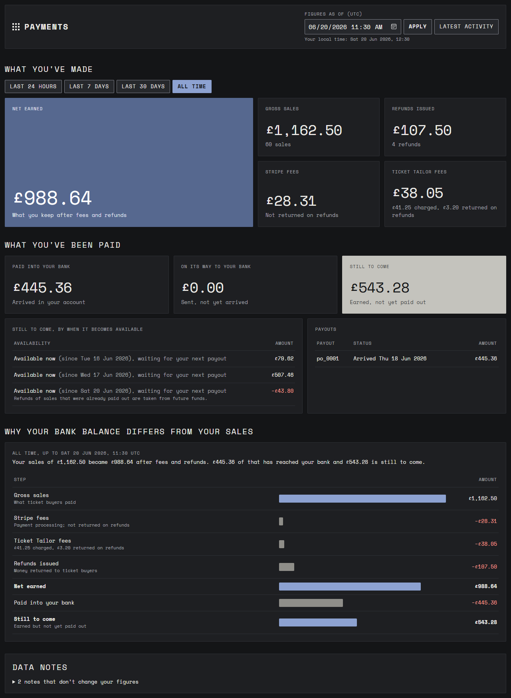

# Organiser Payments Dashboard

A full-stack dashboard that lets an event organiser see their Stripe activity inside Ticket Tailor and answer three
questions:

1. **How much have I made** over the last day, week and month?
2. **How much have I actually been paid**, and when does the rest become available?
3. **Why is the number in my bank different from my sales total?**

**Stack:** ASP.NET Core (.NET 10) API · Angular 22 (standalone, signals, zoneless) · xUnit · Vitest.



<sub>Figures as of the latest activity in the extract (20 June 2026, 11:30 UTC). A [phone-width view](docs/images/dashboard-mobile.png) is also included.</sub>

---

## Contents
- [Quick start](#quick-start)
- [What it reports](#what-it-reports)
- [Architecture](#architecture)
- [Designed to be extended](#designed-to-be-extended)
- [What the data didn't settle, and what I decided](#what-the-data-didnt-settle-and-what-i-decided)
- [Security considerations](#security-considerations)
- [Trade-offs and known limitations](#trade-offs-and-known-limitations)
- [How I know the numbers are right](#how-i-know-the-numbers-are-right)
- [How I used AI](#how-i-used-ai)
- [Next steps](#next-steps)
- [Where to find things](#where-to-find-things)

---

## Quick start

**Prerequisites:** .NET SDK 10.0 and Node.js **24.15 or later** (Angular 22's minimum).

```bash
# 1. API: http://localhost:5214 (reads ./records.json)
dotnet run --project backend/src/Payments.Api --launch-profile http

# 2. Dashboard: http://localhost:4200 (proxies /api to the API, so no CORS set-up is needed locally)
cd frontend
npm ci
npm start
```

Open **http://localhost:4200**. The page opens at the time of the latest record (20 June 2026, 11:30 UTC), because
"last 7 days" measured from today would be empty for this June extract. Change **Figures as of (UTC)** and press
**Apply** to see the position at another moment. For example, at 17 June 12:00 the payout shows as "on its way" rather than
"paid into your bank".

### Tests

```bash
dotnet test backend                       # 126 tests: domain, parsing, service, HTTP
cd frontend && npm test && npm run lint   # 46 tests + ESLint (incl. template accessibility rules)
```

### Talking to the API directly

`backend/src/Payments.Api/Payments.Api.http` has ready-made requests, or:

```bash
curl "http://localhost:5214/api/v1/organisers/acct_demo/dashboard?asOf=2026-06-21T00:00:00Z"
curl "http://localhost:5214/health"
```

| Endpoint | Result |
|---|---|
| `GET /api/v1/organisers/{organiserId}/dashboard?asOf=…` | The dashboard figures. `asOf` is optional (default: now) and must carry a UTC offset |
| Invalid `asOf` / unknown organiser / any write method | `400` / `404` / `405`, always as `application/problem+json` |
| `GET /health` | `Healthy` |

---

## What it reports

All amounts are integer pence until they reach the screen. As of 21 June 2026, after every record:

| Figure | | How it's derived |
|---|---:|---|
| Gross sales | **£1,162.50** | Σ amount of 60 unique successful charges |
| Stripe fees | **£28.31** | Σ `stripe_fee`. Never returned on refunds |
| Ticket Tailor fees | **£38.05** | £41.25 charged − £3.20 returned on refunds (proportional to the amount refunded) |
| Refunds issued | **£107.50** | Σ amount of 4 refunds |
| **Net earned** | **£988.64** | Σ `net` of charges and refunds |
| Paid out to date | **£445.36** | `po_0001`, arrived 18 June |
| **Still to come** | **£543.28** | 16 June £79.62 · 17 June £507.46 · 20 June **−£43.80** |

The dashboard always shows **when money becomes available, never a predicted payout date**: the extract has no payout
schedule. The −£43.80 is a refund of a sale that had already been paid out, so it will come out of a future payout.

---

## Architecture

### Backend: clean architecture with dependencies pointing inwards

```
Payments.Api             HTTP edge: thin controller, ProblemDetails, CORS, security headers, config validation
   │
Payments.Application     use case (DashboardService), DTO contract, mapping, ports (IRecordSource)
   │                                    ▲ implements
Payments.Domain          money rules     Payments.Infrastructure   records.json adapter: parse, de-duplicate, map
```

- **Domain has no dependencies at all:** no framework, no file IO, no clock. Every money rule lives here, as small
  pure functions that are trivial to test:
  - [`Money`](backend/src/Payments.Domain/Shared/Money.cs): `long` pence + currency; mixing currencies throws; arithmetic is `checked`.
  - [`RecordValidator`](backend/src/Payments.Domain/DataQuality/RecordValidator.cs): data integrity.
  - [`RefundFeeRule`](backend/src/Payments.Domain/Reporting/RefundFeeRule.cs): the one place a fee is divided.
  - [`DashboardCalculator`](backend/src/Payments.Domain/Reporting/DashboardCalculator.cs): every figure.
- **The controller is thin.** [`DashboardController`](backend/src/Payments.Api/Controllers/DashboardController.cs) validates
  `asOf`, makes one call to `IDashboardService`, and returns `200`, `400` or `404`. There is no LINQ and no arithmetic in it.
- **The service orchestrates and holds no business rules.** [`DashboardService`](backend/src/Payments.Application/Features/Dashboard/DashboardService.cs)
  is load → validate → calculate → map, in four lines.
- **Dependencies are injected, never fixed in code:**
  - **[`IRecordSource`](backend/src/Payments.Application/Abstractions/IRecordSource.cs) is a port.** Application defines it, and
    [`JsonFileRecordSource`](backend/src/Payments.Infrastructure/Records/JsonFileRecordSource.cs) in Infrastructure is the adapter
    for `records.json`. It loads the file once, thread-safely, and caches the immutable ledger.
  - **`TimeProvider`** is injected, so nothing reads the clock directly and the tests pin time.
- **DTOs are the boundary.** The domain never leaves the Application layer. Services return
  [DTOs](backend/src/Payments.Application/Features/Dashboard/Dtos/), mapped with named arguments so two same-typed
  money fields can't be swapped silently. Money is always `{ amountMinor, currency }`, and enums are sent as strings.

**One straight path:** `DashboardController → IDashboardService → Domain`, which a reviewer can follow with
"Go to implementation".

**Shared folders have a rule.** Code moves to `Shared/` only when a second feature needs it, or when it is a cross-cutting
primitive (money, errors). Shared code never imports from a feature.

### How the data flows

```
records.json ─▶ RecordJson (raw, untrusted) ─▶ Charge / Refund / Payout ─▶ Ledger (sorted, de-duplicated)
            ─▶ RecordValidator (exclude or warn) ─▶ DashboardCalculator ─▶ DashboardSummary
            ─▶ DTOs ─▶ JSON ─▶ Angular store ─▶ presentational components ─▶ money pipe ─▶ screen
```

Three model shapes are kept apart on purpose, so each stays simple: **raw** (loose, matches the file), **domain** (strict,
typed, rules run here) and **DTO** (stable contract for the browser).

### Frontend

```
core/      app-wide services, no UI: API config tokens, error → message mapping
shared/    stateless building blocks: money pipe, <app-money>, stat card, loading/error/empty states, models
features/dashboard/
  dashboard.page.*        container: provides the store, owns the "as of" control and the layout
  data-access/            DashboardApiService (builds the request) + DashboardStore (signals over httpResource)
  components/             presentational, input()/output() only: period summary, payout position,
                          availability table, reconciliation waterfall, data notes
```

- **The UI never computes a money figure.** Every amount shown is a field from the API. The waterfall's bar widths are
  presentation only, and the [money pipe](frontend/src/app/shared/pipes/money.pipe.ts) only moves the decimal point.
- **Every component is `.ts` + `.html` + `.scss`.** There are no inline templates, so markup is read and linted as HTML.
- **Design tokens.** Every colour, font, size and spacing is a CSS variable in [`styles.scss`](frontend/src/styles.scss).
  Components only reference them, and a grep confirms there are no hard-coded colours or fonts. The font (Space Mono) is self-hosted.
- **States:** every view has loading, error-with-retry and empty states. Changing "as of" keeps the figures on screen
  with an "Updating…" note instead of blanking the page.

---

## Designed to be extended

Each rule lives in one place, so a typical change touches a predictable, short list of files.

| Change | What to touch |
|---|---|
| **New period** (e.g. last 90 days) | Add an enum value + one line in [`ReportingPeriod.cs`](backend/src/Payments.Domain/Reporting/ReportingPeriod.cs); the calculator already loops over the enum. Then add the label in `dashboard.models.ts` and `period-summary.component.ts` |
| **New figure** (e.g. average sale) | A property on `SalesBreakdown` → a field on `SalesBreakdownDto` + one mapping line → the matching TypeScript interface → one stat card. Any division goes through a single named function with an explicit rounding mode |
| **New data source** (Stripe API, database) | A new class implementing `IRecordSource`, registered in `AddInfrastructure()`. **Nothing else changes**: not the domain, service, controller, DTOs or UI |
| **New fee type** | Add a `FeeType` value and one `case` in `RecordJsonMapper.FeesOf`. Until then, unknown fees are already kept as "Other fees" and flagged |
| **Fee policy change** | [`RefundFeeRule`](backend/src/Payments.Domain/Reporting/RefundFeeRule.cs) only. Figures come from what the records say actually moved; the rule only *checks* them |
| **Restyle** | The tokens in `styles.scss` |

A project skill, `.claude/skills/add-dashboard-metric`, writes this recipe down step by step, with the tests to add at each layer.

---

## What the data didn't settle, and what I decided

The brief says the data contains cases the rules don't settle. I profiled `records.json` before writing any code
(67 records, 65 unique after de-duplication: 60 charges, 4 refunds, 1 payout). Each decision has an id, and code comments
refer to it, e.g. `// (decision D-5)`.

### Data decisions

| # | In the data | Decision |
|---|---|---|
| A1 | `ch_0005` and `re_0002` delivered twice | De-duplicate by id. Identical copies count once (noted); copies that disagree are all excluded (flagged) |
| A2 | Records not in time order | Never rely on file order; sort by `created` |
| A3 / D-6 | Partial refund `re_0003` (half of £45) | Use the record's own fees and net; check the proportional rule against the **running total** refunded, so partial refunds can't return more fee than was charged. Round half away from zero |
| A4 | `re_0004` refunds a sale that was **already paid out** | A **negative** "still to come" amount on its availability date; "paid out" is not reduced |
| A5 | `ch_0027`–`0030` available on 16 June but not in that day's payout | "Still to come": *available now, waiting for your next payout* |
| A6 | `po_0001` sent 16 June, arrives 18 June | "Paid out" means it has **arrived** in the bank; before that it is "on its way" |
| A7 | Data is from June; "now" is October | The API takes `asOf` (default now); the UI defaults it to the latest record and makes it visible and editable |
| A8 | What does "made" mean? | **Net earned** is the headline, with gross, fees and refunds alongside. A refund counts in the period it was issued, so past periods never change |
| A9 | What is "last week"? | A rolling 7 days ending at "as of" (start exclusive, end inclusive); day = 24h, month = 30 days |
| A10 / D-5 | Missing links, mismatched payouts, wrong signs… (none in this file) | Records that can't be counted safely are excluded; records that can are kept with a warning. Any gap is shown as an explicit line (other fees, unexplained difference, payout discrepancy), so **the figures always add up**, and everything is listed in Data notes |
| A11 | Currency | Totals are grouped by currency and never summed across currencies |
| D-8 / D-9 | Issues about records that didn't exist yet at "as of" | Validate the ledger as it stood at "as of". A refund dated before its own charge is left out until the charge exists |

### Design decisions referenced in the code

| # | Area | Decision |
|---|---|---|
| D-2 | Request path | Controller → one feature service per area → domain. Controllers only validate input and delegate |
| D-11 | Styling | Every colour, font, size and spacing is a CSS variable in `frontend/src/styles.scss`; components reference only those tokens and the shared classes |
| D-12 | Frontend types | The TypeScript interfaces mirror the C# DTOs field for field. A DTO change and its interface change ship together |

---

## Security considerations

- **Tenant isolation is the real control, and this demo doesn't have authentication.**
  - Every query is per organiser, and an unknown organiser gets 404. The organiser id comes from the URL **for the demo only**.
  - In production it must come from the authenticated principal, with a 403 on mismatch, to prevent IDOR.
- **CORS is defence in depth, not a security boundary.** It allows only the configured dashboard origin, GET only, no credentials.
  It stops other websites reading figures through a user's browser; it does nothing against `curl`. The origin is validated at
  startup. In local development the proxy means CORS isn't used at all.
- **Untrusted input:**
  - `records.json` is size-limited (10 MB) and depth-limited.
  - Malformed, duplicate, wrongly-signed or absurd records are reported, never fatal.
  - Amounts are capped to rule out overflow.
  - Timestamps without a timezone are rejected rather than read in server local time.
- **API input:** `asOf` must have a UTC offset and fall within 2000–2099; the organiser id is length-limited; only GET is mapped.
- **No leaks:**
  - Errors go out as `ProblemDetails` with no exception details outside Development (tested).
  - Logs record counts only, never record contents or order references.
  - The dashboard returns aggregates, not individual buyers' records.
- **Hardening:** HSTS and HTTPS redirection outside Development; `X-Content-Type-Options: nosniff` on every response, including 500s.
  Angular escapes all output; there is no `innerHTML` and no sanitizer bypasses.
- **Configuration:** no secrets in the repo. A wrong records path, organiser or CORS origin stops the app **at startup**
  instead of failing every request later.
- **Not applicable here:** CSRF (no writes, no cookie auth) and SQL injection (no database).

---

## Trade-offs and known limitations

- **The extract is read once and cached.** Restart the API to pick up a changed `records.json`. A real source would refresh on
  new Stripe events.
- **Payout status is the status at export time, not at "as of".** A payout that later failed is treated as never having
  moved money, even when viewing an earlier date. A status history would fix this.
- **Minutes, not seconds, in the "as of" control.** Seconds are taken as `:00`.
- **Single demo organiser**, with no authentication (see Security).
- **Same-origin hosting assumed.** The API base URL defaults to the page's own origin (dev uses the proxy); production
  needs a reverse proxy or a configured base URL.

---

## How I know the numbers are right

1. **The expected values came first.** Before writing the domain code I computed every figure from the raw file with a
   separate script (de-duplicated by id): totals, last day and last week, and a mid-week snapshot (17 June, payout
   in transit). These are the [golden figures](backend/tests/Payments.Tests.Shared/GoldenFigures.cs). Where each one comes
   from (pence; duplicates `ch_0005` and `re_0002` counted once):

   | Figure | Value | Derivation |
   |---|---:|---|
   | Gross sales | 116,250 | Σ amount of the 60 unique charges |
   | Stripe fees · TT fees charged · TT fees returned | 2,831 · 4,125 · 320 | Σ `stripe_fee` on charges · Σ `application_fee` on charges · −Σ `application_fee` on refunds |
   | Refunds issued | 10,750 | Σ amount of `re_0001`–`re_0004` |
   | **Net earned** | **98,864** | 116,250 − 2,831 − 4,125 + 320 − 10,750, which also equals Σ net of every charge and refund |
   | Paid out | 44,536 | `po_0001`, which equals Σ net of the 26 transactions it covers (`ch_0001`–`ch_0026`) |
   | Still to come, 16 June | 7,962 | `ch_0027`–`ch_0030`: available that day, not in the payout |
   | Still to come, 17 June | 50,746 | `ch_0031`–`ch_0060` less `re_0001`–`re_0003` |
   | Still to come, 20 June | −4,380 | `re_0004`, refunding `ch_0007`, which was already paid out |
   | Last 24 hours to 21 June | −4,380 net | `re_0004` only: no sales that day |
   | Last 7 days to 21 June | 46,366 net (60,350 gross) | `ch_0031`–`ch_0060` (Sunday's sales) plus all four refunds |
   | 17 June 12:00 snapshot | 103,244 net · 0 paid · 44,536 on its way · 58,708 to come | `po_0001` sent, not yet arrived; `re_0004` not yet issued |
2. **Independent re-computation.** Reviewer agents recomputed the figures again with their own Node scripts, once from the
   domain and once **through the running HTTP API and the rendered page**, clicking through each period.
3. **An external anchor.** `po_0001`'s amount (44,536) is Stripe's own figure. The nets of the 26 transactions it covers
   add up to exactly that, which confirms our reading of "net" against real money that moved.
4. **Accounting identities.** `gross − fees − refunds = net` and `paid out + in transit + still to come = net` are asserted
   on every test fixture and at five points across the weekend, independent of any expected value.
5. **The tests can fail.** I deliberately broke the code and checked the tests caught it:
   - dropped refunds from net earned → 7 failures;
   - counted a payout as paid before it arrived → 1 failure;
   - swapped "TT fees charged" and "returned" in the DTO mapping → 3 failures, including over HTTP;
   - removed the refund sign check → 1 failure.
6. **Small hand-checkable cases** for every edge: a £45 charge with a £1.20 fee refunded by half returns £0.60; 125p over two
   half refunds returns 63 + 62, never 63 + 63.

**What this can't prove:** that my *interpretations* (A1–A11) match Ticket Tailor's intent. The code and my check share
them. That is why every interpretation is written down as a decision to discuss rather than buried in code.

---

## How I used AI

I built this with **Claude Code** (Claude Opus). I treated it as a fast pair: it proposed and implemented, I set the
direction, made the calls and pushed back.

### How I set it up
- **Before any code:** I had it explain the problem back to me and profile `records.json`. The edge cases (A1–A11) came out
  of that, and **I approved them** before implementation started.
- **Guard rails:** [CLAUDE.md](CLAUDE.md) holds the working agreement:
  - plan before code, and get approval;
  - never "fix" a test by changing its expected number;
  - every ambiguity becomes a recorded decision.

  Path-scoped rules in `.claude/rules/` cover money, .NET, Angular, testing and security. Skills in `.claude/skills/` cover
  the domain, verifying numbers, adding a metric and recording decisions.
- **Independent reviewers:** three review subagents (`payments-correctness`, `dotnet`, `angular`) reviewed every slice.
  Their findings came back to me as a list, and **I approved each fix list** before anything changed.
- **Slices:** I built it in slices (domain → API → UI), each one reviewed, fixed and re-reviewed before moving on, with a
  single commit at the end.

### How I directed it
I set the patterns the code had to follow and held each slice to them, rather than accepting what came back.

- **Standards before code.** I had the rules, skills and review agents written *before* any implementation, and
  reviewed them, so every slice was held to the same strict standards:
  - money as integer pence, and no clock in the domain;
  - thin controllers, and every ambiguity recorded as a decision;
  - a separate reviewer for money correctness, .NET and Angular.
- **Thin controllers.** I chose controllers with a clear folder structure and one straight path: controller → one
  feature service (`IDashboardService`) → domain. Controllers only validate input and delegate.
- **Shared code only when it's really shared.** I asked for shared folders for reused DTOs and helpers, with a rule
  against them becoming dumping grounds. Code moves to `Shared/` only when a second feature needs it.
- **A data-source abstraction I can defend.** I kept the `IRecordSource` port and tested it against real change. I asked
  how a database, the Stripe API or webhooks would slot in. The answer is a new adapter registered in one place, with no
  change to the domain, service, controller or UI. That's what makes the data source replaceable.
- **Partial and inconsistent data.** For a refund dated before its own charge (D-9), I chose to leave it out of the
  figures until the charge exists, and flag it, rather than show an unexplained negative. In a production system I'd go
  further and store inconsistent records in a separate quarantine table for review. For this extract, excluding and
  flagging them was the right result.
- **Front-end conventions.** I required every component to have its own `.html` and `.scss` file (no inline templates)
  and made it a project rule, so markup is readable and linted as HTML.
- **Making sure I understood it.** Before writing this, I had the code walked through end to end:
  - how a request flows and where the data is cached;
  - how the raw records, domain types and DTOs relate, with one refund traced through every layer;
  - how a fee-policy change would reach the dashboard;
  - why CORS matters for a read-only API.

  I also questioned whether hand-written golden figures are a real test, which led to the account of what they do and
  don't prove in [How I know the numbers are right](#how-i-know-the-numbers-are-right).

### What I kept, rejected or had corrected
The reviewers and tests caught real problems in AI-written code. A selection:

- **Rejected/corrected: a double-refund hole.** A refund with a negative amount passed the over-refund check and could let a sale
  be refunded twice. Fixed with explicit sign rules.
- **Corrected: crashes on hostile input.** A `null` inside `fee_details` or a payout's id list crashed the whole parse. Now each bad record is reported.
- **Corrected: silent imbalances.** Records kept with a warning broke the "everything adds up" identities, so I had
  explicit reconciliation lines added (D-5) and the identities asserted on every fixture.
- **Corrected: wrong signs on screen.** The payout discrepancy displayed with the wrong sign, and the AI's own test had pinned
  the wrong expectation. A negative fee (a credit) also showed as money going out.

### What I'd take from it
AI was fast and produced well-structured code, but on its own it **missed edge cases in money handling**.
The value came from the guard rails: written decisions, independent golden figures, mutation checks, and separate
reviewers whose findings I triaged before anything changed.

---

## Next steps

- Authentication, with the organiser taken from the principal; then rate limiting and audit logging of who viewed what.
- A real record source: Stripe API or webhooks into a database, behind `IRecordSource`.
- Payout status history, so past views reflect the status at that time.
- Calendar periods (e.g. "this month") in the organiser's time zone.
- A Content-Security-Policy for the frontend, and `AllowedHosts` restricted per environment.
- Treat a client-cancelled request as a cancellation rather than logging it as an error.

---

## Where to find things

| | |
|---|---|
| [docs/ARCHITECTURE.md](docs/ARCHITECTURE.md) | Full folder structure and the shared-folder rules |
| [CLAUDE.md](CLAUDE.md) and `.claude/` | The AI working agreement, rules, skills and reviewer agents |
| `backend/` | `src/` (Domain, Application, Infrastructure, Api) · `tests/` (4 test projects + shared fixtures) |
| `frontend/` | Angular app (`src/app/core`, `shared`, `features/dashboard`) |
